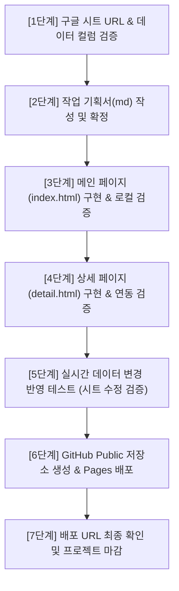

# [작업 기획서] 2026 부산대학교 직무연수 안내 웹사이트 구축 & GitHub Pages 배포

- **작성일자**: 2026-10-11
- **프로젝트 위치**: `C:\Antigravity\Site development\2026-10-11\`
- **디자인 표준**: `frontend-design` 스킬 가이드라인 적용
- **배포 목표**: GitHub Public Repository & GitHub Pages

---

## 1. 프로젝트 개요 & 목적

### 1.1 목표
2026년도 부산대학교 교직원(일반직, 전임교원, 연구원, 조교, 대학회계직 등)을 위한 직무연수 프로그램을 한눈에 탐색하고, 세부 교육 내용을 확인하여 신청할 수 있는 **메인(index.html)·상세(detail.html) 2페이지 반응형 웹사이트**를 구축합니다.

### 1.2 핵심 원칙
1. **구글 시트 실시간 데이터 연동**: 데이터를 하드코딩하지 않고, 구글 시트 gviz CSV API와 **PapaParse**를 통해 페이지가 로드될 때마다 실시간으로 데이터를 가져옵니다. 시트 수정 후 새로고침 시 즉각 반영됩니다.
2. **독창적이고 완성도 높은 시각 디자인 (`frontend-design`)**: 단순한 템플릿형 부트스트랩/SaaS 룩을 지양하고, 부산대학교의 전통과 미래지향적 혁신을 담아낸 **PNU Royal Blue & Green 아이덴티티**, 섬세한 반응형 타이포그래피, 시그니처 인터랙션을 적용합니다.
3. **단계별 검증 진행 (Step-by-Step)**: 한 번에 한 단계씩 구현하고 브라우저 검증을 거친 후 다음 단계로 이행합니다.
4. **결과물 일자별 보존**: `2026-10-11` 폴더 내에 모든 기획서, 스크립트, 소스 코드 및 검증 결과물을 보존합니다.

---

## 2. 구글 시트 연동 명세 & 데이터 구조

### 2.1 구글 시트 엔드포인트
- **시트 ID**: `1F5nDh8rVL5PCrYB9JgMBB68OJjXiAtVdJpvqvkGnmUw`
- **시트 탭**: `data`
- **연동 URL (gviz CSV 방식)**:
  ```text
  https://docs.google.com/spreadsheets/d/1F5nDh8rVL5PCrYB9JgMBB68OJjXiAtVdJpvqvkGnmUw/gviz/tq?tqx=out:csv&sheet=data
  ```
- **캐시 방지 파라미터 적용**: `&_t=${Date.now()}` 추가를 통해 브라우저 캐싱을 방지하고 항상 최신 시트 데이터를 수신합니다.
- **파서**: PapaParse (v5.4.1 CDN, 쉼표·개행 문자 포함 필드 안정적 파싱).
- **네트워크/권한 Fallback 대비**: 구글 시트가 401(비공개)이거나 오프라인일 때도 서비스가 중단되지 않도록 로컬 백업 CSV(`data_backup.csv`, 32건 완비)를 자동 로드하는 안전장치 탑재.

### 2.2 컬럼 스키마 및 활용 방안 (총 17개 컬럼)

| 번호 | 컬럼명 | 데이터 예시 | 활용 페이지 및 용도 |
| :---: | :--- | :--- | :--- |
| **1** | **과정코드** | `PNU-2026-001` | **고유 식별자(PK)**, 상세 페이지 URL 파라미터(`detail.html?code=PNU-2026-001`) |
| **2** | **과정명** | 직장 내 성희롱·성폭력 예방 교육 | 메인 카드 타이틀, 상세 페이지 메인 타이틀, 키워드 검색 대상 |
| **3** | **분야** | 법정의무교육, 직무역량, AI·데이터 등 | **핵심 필터 1** (10개 카테고리 태그 칩 및 뱃지) |
| **4** | **대상** | 전 직원, 관리자, 실무자, 신규자 | **핵심 필터 2** (대상별 맞춤 필터링) |
| **5** | **이수구분** | 필수, 필수(해당자), 권장, 선택 | **핵심 필터 3** 및 카드 상단 컬러 강조 뱃지 |
| **6** | **교육방식** | 온라인, 집합, 혼합 | **핵심 필터 4** (비대면/대면 교육 아이콘 및 태그) |
| **7** | **교육시간** | 1시간, 6시간, 16시간 | 교육 분량 메타 정보 표시 |
| **8** | **정원** | 무제한, 30명, 50명 | 잔여/정원 정보 표시 |
| **9** | **교육기간** | 상시(2026-01-02~12-31), 2026-04-10~... | 교육 일정 안내 |
| **10** | **신청기간** | 상시, 2026-03-01~03-25 | 접수 상태(접수중/마감임박/상시) 뱃지 계산 기준 |
| **11** | **담당부서** | 인재개발원, 정보화본부, 총무과 등 | 부서별 필터 및 문의 안내 |
| **12** | **한줄소개** | 모든 구성원이 연 1회 반드시 이수하는... | 메인 목록 카드 요약 설명 |
| **13** | **상세소개** | 「양성평등기본법」에 따라... | 상세 페이지 개요 본문 단락 |
| **14** | **학습목표** | 개념 이해 · 예방 수칙 습득 · 신고절차 | 상세 페이지 체크리스트 블록 |
| **15** | **주요내용** | 관련 법령과 정의 · 유형별 사례 분석... | 상세 페이지 모듈별 커리큘럼 테이블 |
| **16** | **신청링크** | https://hrd.pusan.ac.kr/course/... | 상세 페이지 '수강신청 바로가기' CTA 버튼 |
| **17** | **문의** | 인재개발원 051-510-1231 | 상세 페이지 담당자 전화 및 문의처 블록 |

---

## 3. Frontend Design 기반 디자인 시스템 (`frontend-design`)

### 3.1 브랜드 아이덴티티 & 컬러 팔레트 (Design Tokens)
템플릿화된 AI 디자인(단순 베이지/크림색 또는 획일화된 다크테마)을 배제하고, 부산대학교의 상징색과 신뢰감 높은 아카데믹 톤을 결합한 6색 토큰을 정의합니다.

```css
:root {
  /* 1. PNU Core Blue (브랜드 핵심: 신뢰와 권위) */
  --pnu-blue-primary: #004098;
  --pnu-blue-dark: #00265c;
  --pnu-blue-light: #005bac;

  /* 2. PNU Green (효원의 상징: 성장, 완료, 필수 뱃지) */
  --pnu-green: #00873d;
  --pnu-green-light: #e6f4ea;

  /* 3. Academic Slate (가독성 높은 텍스트 및 헤더 백그라운드) */
  --pnu-text-main: #0f172a;
  --pnu-text-muted: #475569;
  --pnu-text-caption: #64748b;

  /* 4. Canvas Neutral (눈이 편안한 아카데믹 백그라운드) */
  --pnu-bg-canvas: #f8fafc;
  --pnu-bg-surface: #ffffff;
  --pnu-border: #e2e8f0;

  /* 5. Accent Amber (접수 마감 임박, 필수 알림) */
  --pnu-accent-amber: #d97706;
  --pnu-accent-amber-light: #fef3c7;

  /* 6. Signature Shadow & Radius */
  --radius-card: 1rem;
  --radius-chip: 9999px;
  --shadow-subtle: 0 4px 20px -2px rgba(0, 32, 96, 0.05);
  --shadow-elevated: 0 16px 36px -12px rgba(0, 32, 96, 0.12);
}
```

### 3.2 타이포그래피 (Typography Hierarchy)
- **헤드라인 & 디스플레이**: `Pretendard (Bold 700 / ExtraBold 800)`
- **서브헤더 & 영문 워드마크**: `Montserrat (SemiBold 600, Uppercase, Tracking 0.08em)`
- **본문 및 데이터**: `Pretendard (Regular 400, Medium 500)`, 코드 및 일자 표기 시 고정폭/타블라 폰트 활용

### 3.3 시그니처 비주얼 요소 (Signature Visuals)
1. **헤더 반응형 엠블럼 로고**: 데스크톱·태블릿·모바일 해상도별 심볼(46px/38px/34px) 및 워드마크 지능형 축소.
2. **Hero 상단 인터랙티브 현황 바**: 총 32개 연수 과정 실시간 로드 집계(필수 과정 수, 온라인 과정 비율, 신규 과정 수)를 카운터 칩으로 표현.
3. **스티키 필터 데크 (Sticky Filter Deck)**: 스크롤 시 검색창과 분야별 칩이 상단에 부드럽게 고정되어 언제든 원하는 과정을 즉시 필터링.
4. **상태별 시각 피드백**: '필수' 연수는 PNU 블루 테두리 및 뱃지, '온라인' 연수는 비대면 아이콘 배지로 직관성 부여.

---

## 4. 웹사이트 아키텍처 및 폴더 구조

작업 결과물은 모두 `C:\Antigravity\Site development\2026-10-11\` 내에 저장되며, 추후 GitHub 저장소 루트로 그대로 배포됩니다.

```text
C:\Antigravity\Site development\2026-10-11\
├── PLAN_2026_PNU_TRAINING_SITE.md   # 본 작업 기획서 (md)
├── index.html                       # 메인 페이지 (전체 연수 안내, 검색·필터, 카드 목록)
├── detail.html                      # 상세 페이지 (과정별 상세 소개, 목표, 내용, 신청)
├── data_backup.csv                  # 실시간 시트 장애/오프라인 대비 로컬 원본 백업
├── assets/
│   ├── logo.png                     # 부산대학교 공식 엠블럼 로고
│   └── icons/                       # UI 인라인 SVG 또는 아이콘셋
├── css/
│   ├── header.css                   # 반응형 글로벌 헤더 스타일
│   ├── main.css                     # 메인 페이지 및 카드 그리드, 필터 스타일
│   └── detail.css                   # 상세 페이지 및 커리큘럼 레이아웃 스타일
└── js/
    ├── sheet-api.js                 # 구글 시트 gviz CSV 호출 & PapaParse 실시간 로더
    ├── main.js                      # 메인 페이지 검색/필터/렌더링 로직
    └── detail.js                    # 상세 페이지 URL 파라미터 파싱 & 단일 과정 렌더링
```

---

## 5. 두 페이지 구성요소 및 UI 레이아웃 분해

### 5.1 메인 페이지 (`index.html`)

```text
+------------------------------------------------------------------------+
| [Header] 부산대학교 엠블럼 + 워드마크 | 홈 | 연수목록 | 교육안내 | [포털 로그인] |
+------------------------------------------------------------------------+
| [Hero Section]                                                         |
|   "2026 부산대학교 교직원 직무연수 카탈로그"                              |
|   전문성과 미래를 여는 교육과정 안내 (총 32개 과정 집계 칩)              |
+------------------------------------------------------------------------+
| [Sticky Search & Filter Deck]                                          |
|   - 검색어 입력창 [ 🔍 과정명, 담당부서, 키워드 검색... ]                 |
|   - [이수구분] 전체 | 필수 | 필수(해당자) | 권장 | 선택                |
|   - [교육방식] 전체 | 온라인 | 집합 | 혼합                              |
|   - [대상구분] 전체 | 전 직원 | 실무자 | 관리자 | 신규자                |
|   - [분야 태그 슬라이더] 법정의무 | 대학행정 | AI·데이터 | 안전보건 등   |
+------------------------------------------------------------------------+
| [Result Bar] 검색 결과 총 [ N ]개 과정 (초기화 버튼)                    |
+------------------------------------------------------------------------+
| [Course Card Grid] (3열 반응형 그리드)                                  |
|   +-------------------+  +-------------------+  +-------------------+  |
|   | [필수][온라인]     |  | [선택][집합]       |  | [필수][혼합]       |  |
|   | PNU-2026-001      |  | PNU-2026-015      |  | PNU-2026-020      |  |
|   | 성희롱 예방 교육  |  | 기획서 작성 실무   |  | 인공지능 업무활용  |  |
|   | 한줄 소개...      |  | 한줄 소개...      |  | 한줄 소개...      |  |
|   | ⏱ 1시간 | 전 직원 |  | ⏱ 6시간 | 실무자   |  | ⏱ 4시간 | 전 직원   |
|   | [상세보기 →]       |  | [상세보기 →]       |  | [상세보기 →]       |  |
|   +-------------------+  +-------------------+  +-------------------+  |
+------------------------------------------------------------------------+
| [Empty State] 검색 결과가 없을 때 일러스트 & 검색 초기화 버튼 제공      |
+------------------------------------------------------------------------+
| [Footer] 부산대학교 정보, 직무연수 문의처, 저작권 표기                  |
+------------------------------------------------------------------------+
```

### 5.2 상세 페이지 (`detail.html`)

```text
+------------------------------------------------------------------------+
| [Header] 부산대학교 엠블럼 + 워드마크 | 홈 | 연수목록 | 교육안내 | [포털 로그인] |
+------------------------------------------------------------------------+
| [Breadcrumb] 홈 > 직무연수 안내 > [분야명] > [과정코드]                 |
+------------------------------------------------------------------------+
| [Course Hero Header]                                                   |
|   [필수 뱃지] [교육방식 뱃지] [분야 태그]                                |
|   과정명: 직장 내 성희롱·성폭력 예방 교육 (PNU-2026-001)                 |
|   한줄소개 텍스트 강조                                                  |
+------------------------------------------------------------------------+
| [2-Column Content Layout]                                              |
|                                                                        |
|  [Left: 주요 본문 영역 (65%)]          [Right: 스티키 신청/메타 (35%)] |
|  1. 교육 상세 소개                     +-----------------------------+ |
|     - 법적 근거 및 교육 취지 본문      | 📋 교육 핵심 정보           | |
|                                        | - 대상: 전 직원             | |
|  2. 학습 목표 (체크리스트)             | - 교육방식: 온라인          | |
|     ✓ 성희롱·성폭력 개념 이해          | - 교육시간: 1시간           | |
|     ✓ 예방 수칙과 행동요령 습득        | - 정원: 무제한              | |
|     ✓ 신고·처리 절차 숙지              | - 교육기간: 상시            | |
|                                        | - 신청기간: 상시            | |
|  3. 주요 내용 (커리큘럼 테이블)        | - 담당부서: 인재개발원      | |
|     - 모듈 1: 법령 및 정의             | --------------------------- | |
|     - 모듈 2: 유형별 사례 분석         | [ 🚀 수강신청 바로가기 ]   | |
|     - 모듈 3: 피해자 지원 체계         | [ 🔗 링크 복사하기 ]        | |
|                                        | --------------------------- | |
|  4. 유의사항 및 이수 기준              | 📞 문의: 051-510-1231       | |
|     - 미이수자 개별 통보 안내          +-----------------------------+ |
|                                                                        |
|  [ ← 연수 목록으로 돌아가기 버튼 ]                                     |
+------------------------------------------------------------------------+
| [Footer] 부산대학교 정보, 직무연수 문의처, 저작권 표기                  |
+------------------------------------------------------------------------+
```

---

## 6. 기능 단위(Feature)별 세부 구현 명세

### [F-01] 실시간 시트 데이터 패치 & PapaParse 처리 (`sheet-api.js`)
- **역할**: 구글 시트 gviz CSV 호출 및 파싱, 메모리 캐싱, 오류 시 로컬 백업 로드
- **작동 순서**:
  1. `fetch(GVIZ_URL + '&_t=' + Date.now())` 실행.
  2. 성공 시 수신된 CSV 텍스트를 `Papa.parse(csvText, { header: true, skipEmptyLines: true })`로 파싱하여 객체 배열 생성.
  3. 만약 401(권한 에러) 또는 네트워크 실패 시 즉시 `data_backup.csv`로 fallback 로드.
  4. 파싱된 데이터 배열을 `window.PNU_TRAINING_DATA` 전역 상태로 보관하고 로딩 인디케이터 해제.

### [F-02] 다차원 복합 필터링 & 디바운스 실시간 검색 (`main.js`)
- **역할**: 사용자가 입력한 검색어와 선택한 뱃지 조건(AND 조건)으로 연수 목록 실시간 필터링
- **필터 조건**:
  - `검색어`: 과정명, 과정코드, 담당부서, 한줄소개, 상세소개 포함 여부 (대소문자/공백 무시, 150ms 디바운스)
  - `이수구분`: 전체 / 필수 / 필수(해당자) / 권장 / 선택
  - `교육방식`: 전체 / 온라인 / 집합 / 혼합
  - `대상`: 전체 / 전 직원 / 실무자 / 관리자 / 신규자
  - `분야`: 10개 분야 태그 칩 클릭 토글
- **반응성**: 조건 변경 시 즉각 0.15초 이내 부드러운 카드 페이드 전환 및 결과 카운터 갱신.

### [F-03] URL Query Parameter 기반 상세 데이터 바인딩 (`detail.js`)
- **역할**: `detail.html?code=PNU-2026-001` 형태로 전달된 과정코드를 감지하여 해당 연수 데이터만 동적 렌더링
- **로직**:
  1. `const code = new URLSearchParams(window.location.search).get('code');`
  2. `sheet-api.js`로 전체 데이터 로드 후 `code`와 일치하는 연수 객체 검색.
  3. 존재할 경우 페이지 타이틀 및 각 섹션(소개, 목표, 주요내용, 신청링크, 문의처)에 데이터 바인딩.
  4. 코드가 없거나 잘못된 코드인 경우 "존재하지 않는 과정입니다" 안내 및 목록 이동 버튼 노출.

### [F-04] 수강신청 링크 및 공유 인터랙션
- **역할**: 시트의 `신청링크` 컬럼 URL로 새 창 연결 (`target="_blank"`), 현재 페이지 URL 클립보드 복사(토스트 팝업 알림).

---

## 7. 단계별 개발 및 검증 로드맵 (Step 1 ~ Step 7)

본 프로젝트는 사용자 요청에 따라 **한 번에 한 단계씩 진행하며, 각 단계가 정상 동작하는지 검증을 완료한 후 다음 단계로 이행**합니다.



### 단계별 상세 체크리스트

| 단계 | 수행 작업 내용 | 산출물 및 확인 방법 (Checklist) |
| :---: | :--- | :--- |
| **1단계**<br>*(완료)* | • 구글 시트 URL 구조 및 gviz 엔드포인트 확인<br>• 실제 17개 컬럼 및 32건 데이터 스키마 정밀 분석<br>• 백업 데이터셋(`data_backup.csv`) 확보 | • `sample_sheet_data.json` 및 `categories.json` 확인 완료<br>• `data_backup.csv` 생성 완료 |
| **2단계**<br>*(현재 단계)* | • 폴더 구조, 두 페이지 구성요소, 연동/검색/필터 기능 기획서 작성<br>• `frontend-design` 스킬 기반 디자인 토큰 및 시그니처 정의 | • 본 기획서 `PLAN_2026_PNU_TRAINING_SITE.md` 작성 및 사용자 공유 |
| **3단계** | • `2026-10-11` 폴더에 `index.html`, `main.css`, `main.js`, `sheet-api.js` 구현<br>• PapaParse 연동, Hero 통계, 다차원 필터링 및 카드 그리드 렌더링 검증 | • `agent-browser`로 로컬 실행 후 검색/필터 동작 및 스크린샷 검증 |
| **4단계** | • `detail.html`, `detail.css`, `detail.js` 구현<br>• 메인 페이지 카드 클릭 시 상세 페이지로 이동 및 파라미터 기반 동적 렌더링 검증 | • 카드 클릭 → 상세 페이지 전환 확인<br>• 상세 내용, 체크리스트, 신청 CTA 버튼 정상 출력 검증 |
| **5단계** | • 구글 시트 실시간 연동 테스트<br>• 시트 데이터 변경 시 새로고침 후 사이트에 즉각 반영되는지 브라우저에서 검증 | • 실시간 갱신 확인 및 변경 내역 스크린샷 캡처 |
| **6단계** | • GitHub CLI(`gh`) 또는 Git 명령어로 신규 Public 저장소 생성<br>• `2026-10-11` 폴더 산출물 푸시 및 Settings > Pages 배포 활성화 | • GitHub Actions / Pages 배포 활성화 확인 |
| **7단계** | • 생성된 GitHub Pages 라이브 URL 접속 검증<br>• 배포 URL 및 저장소 주소 최종 정리 보고 | • 최종 URL 확인 및 마감 |

---

## 8. 결론 및 다음 단계 실행 준비
본 작업 기획서는 사용자 요구사항과 `frontend-design` 스킬의 지침을 완벽히 수용하여 작성되었습니다. 사용자의 확인 후 **[3단계: 메인 페이지(index.html) 구현]**으로 즉시 착수합니다.
